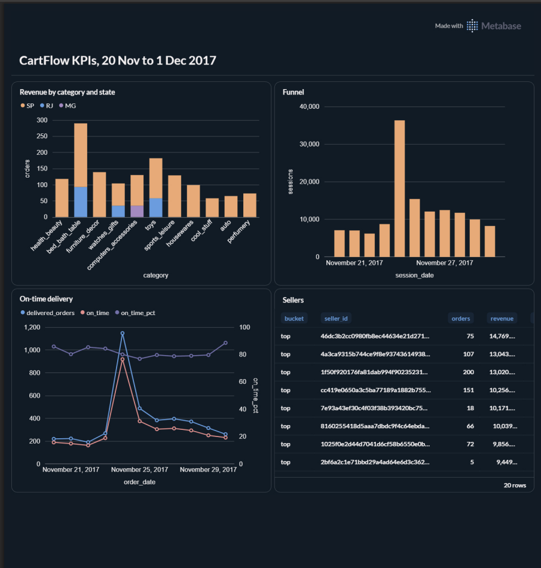
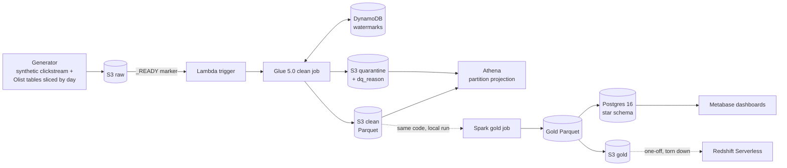

# CartFlow: a serverless e-commerce lakehouse on AWS

An event-driven data platform built on the public Olist Brazilian e-commerce dataset. Daily files land in S3, a Lambda starts a Glue job that cleans and quarantines bad rows, Athena queries the result with no crawlers, and a Spark job builds a star schema (with a Type 2 customer dimension) that is loaded into Postgres and, as a one-off, Redshift Serverless. Every load is idempotent, every layer is reconciled against the one before it, and the dashboards run on the Black Friday 2017 window.



## What it demonstrates

| Area | What is in the repo |
|---|---|
| Event-driven ingestion | S3 `_READY` marker triggers a Lambda that starts a Glue job per day. A DynamoDB watermark makes retries and duplicate triggers harmless. |
| Data quality | Declarative rules in `dq/rules.yaml`. Bad rows go to a quarantine zone with a reason; nothing is silently dropped. |
| Lakehouse querying | Athena external tables generated from the schemas, partition projection instead of crawlers. |
| Dimensional modelling | Star schema with a Type 2 customer dimension, half-open validity ranges and database-enforced invariants. |
| Incremental loads | `MERGE` with change detection, loaded in one transaction with invariant checks that roll back on any violation. |
| Infrastructure as code | Terraform for buckets, IAM (least privilege), Glue, Lambda, Athena, and an `enable_redshift` switch so the warehouse can be created and destroyed with one command. |
| Verification | 47 pytest tests, a three-way reconciliation (raw, clean, warehouse) and a Postgres-vs-Redshift reconciliation of counts and money totals. |

## Architecture



The clean job is storage-agnostic (local paths or S3), so the same code runs under pytest, locally, and on Glue. The gold layer is built locally from the clean layer and uploaded to S3 for Redshift. Details and the reasoning behind each choice are in [docs/architecture.md](docs/architecture.md).

## Results

All numbers come from the committed evidence in `docs/` and the reconciliation scripts.

**Pipeline.** 12 simulated daily loads (20 Nov to 1 Dec 2017). Clean layer: 197,639 events. Quarantine: 2,979 events. Glue runs take about 1.5 minutes on 2 DPUs ([run history](docs/img/glue_runs.png)).

**Cost.** The whole AWS build cost $0.68, across 26 Glue runs, Athena queries and the Redshift Serverless load.

**Warehouse.** 4,380 orders, 5,062 order items, 135,349 sessions, 4,321 customers (4,322 dimension rows: one real customer changed address and is tracked as a Type 2 change), 32,951 products, 3,095 sellers.

**Reconciliation.** Postgres and Redshift agree on all 14 checks: row counts and money totals to the cent ([screenshot](docs/img/redshift_reconcile.png)). A separate three-way check traces each order from raw to clean to warehouse and lists the rejected ones: one delivered order has no delivery date, so a quality rule quarantined it, and the check shows the exact money difference that causes.

**Athena: raw vs Parquet** (same four queries, median of 3 runs, bytes scanned from Athena's own statistics; [full table](docs/benchmark.md)):

| Query | Raw scanned | Clean scanned | Reduction |
|---|---:|---:|---:|
| One day, events by type | 5.07 MB | 0.01 MB | over 99% |
| Whole window, session funnel | 19.22 MB | 6.84 MB | 64% |
| Whole window, mobile events per day | 19.22 MB | 0.06 MB | over 99% |
| Revenue by order status (join) | 0.55 MB | 0.32 MB | 42% |

This mixes three effects (compression, columnar reads, typing) and the data is tiny, so I quote the ratio, not a cost saving: Athena bills a 10 MB minimum per query. Engine time at this size is fixed overhead and is not a speedup.

**KPIs** are defined precisely in [docs/metrics.md](docs/metrics.md) (funnel, revenue by category and state, on-time delivery, top and bottom sellers). Black Friday is the peak at 36,330 sessions and 1,174 purchases, and on-time delivery drops from about 85% to 77-80% that week.

## Engineering decisions worth reading

- **Idempotency everywhere.** Dynamic partition overwrite in Glue, a watermark that moves last, `MERGE` guarded by `IS DISTINCT FROM`, and a reload test that proves counts do not change.
- **Constraints in the database, not in hope.** The SCD2 dimension uses half-open ranges, a partial unique index (one current row per customer) and CHECK constraints, so a buggy loader fails loudly instead of corrupting history.
- **Quarantine, don't drop.** Every rejected row is kept with a reason, which is why the reconciliation can explain every difference.
- **Business day is the Brazil date.** Timestamps are UTC in storage and converted for day logic. A test pins this because it is the classic way to be off by one day.
- **Reached-semantics funnel.** A session that purchased counts as carted and checked out even if one of those events was quarantined, which keeps the funnel monotone.
- **Redshift is not Postgres.** `MERGE` has no `AND` condition, `IS DISTINCT FROM` is undocumented, `COPY` from Parquet maps columns by position, constraints are informational only, and `TRUNCATE` commits implicitly. The Redshift SQL in `sql/redshift/` is written for those differences, with `DISTKEY(order_id)` on the two order facts so their join is co-located.

## Things that went wrong (and what they taught me)

- **A reconciliation caught a bug that every per-load check missed.** The Redshift loader found its list of days from `fact_orders` only, so a day with late-arriving sessions but no orders was skipped. Sessions were 129 short. After fixing the loader, 35 purchased sessions were still stale, because re-loading an older day overwrote newer session versions. Replaying in date order fixed it.
- **A data-quality rule explained a "failed" reconciliation.** My first expectation was wrong, not the pipeline. The check was rewritten to list rejected orders and quantify them.
- **A hidden column.** DuckDB's Hive partition detection silently added a `dt` column to a staging load. Found by reading the output, fixed with an explicit setting.

## Known limitations

- **Session loads are order-dependent.** Sessions are replaced wholesale, so replaying an older day after newer ones can regress a session. Replaying in date order is safe; a version guard (skip staged sessions with fewer events than the stored row) would make any order safe. Not implemented.
- **Redshift was a one-off.** It was provisioned with Terraform, loaded, reconciled and destroyed to avoid cost (4 RPU base, a 40 RPU-hour monthly usage limit). The Redshift loader needs AWS, so CI cannot run it.
- **Dashboards are Metabase on local Postgres, not QuickSight.** The sandbox account's service control policy denies QuickSight, so I did not use it.
- **The clickstream is synthetic.** Orders and customers are real Olist records; events are generated (seeded) and linked by anonymised IDs. They do not describe real behaviour.
- **Small data.** Benchmarks show ratios, not production cost. The gold build runs locally rather than on a cluster.
- **Category names** include upstream Olist typos (for example `costruction_tools_garden`) and an `unknown` bucket. They are left as published.

## Run it

Requirements: Python 3.11+, Docker, and for the AWS part an account and Terraform. Download the Olist files yourself (see below) into `data/olist/`.

```bash
python -m venv .venv && source .venv/bin/activate
python -m pip install -r requirements.txt
pytest                                          # 47 tests; the warehouse tests skip if Postgres is down

# --- local pipeline ---
python generator/gen_events.py                  # seeded synthetic clickstream (defaults: 2017-11-20 to 2017-11-30)
python generator/slice_tables.py                # slice the Olist tables into one folder per day
python generator/replay.py --all --target local # ship every day to the local raw zone, _READY marker last
for d in $(ls data/local_lake/raw | sed 's/dt=//' | sort); do
  python -m glue_jobs.clean_daily --dt "$d"     # clean job, one day at a time (idempotent)
done

docker compose up -d                            # Postgres warehouse (port 5433) and Metabase (port 3000)
bash scripts/gold_all.sh                        # per day: build gold Parquet, then load the star schema
python scripts/reconcile.py                     # raw vs clean vs warehouse

# --- AWS (region us-east-2) ---
python scripts/build_glue_zip.py
terraform -chdir=infra init && terraform -chdir=infra apply
source scripts/replay_s3.sh                     # replay_day <date> pushes a day to S3 and waits for Glue
python scripts/make_athena_ddl.py --clean-bucket <clean> --quarantine-bucket <quarantine>
python scripts/make_raw_ddl.py --raw-bucket <raw>
python scripts/athena_bench.py                  # writes docs/benchmark.md

# --- Redshift (costs money while queries run) ---
terraform -chdir=infra apply -var enable_redshift=true
python -m warehouse.load_day_redshift --all --gold-bucket <gold>
PYTHONPATH=. python scripts/reconcile_redshift.py
terraform -chdir=infra apply                    # tears Redshift down (default is false)
```

## Repository layout

```
generator/    synthetic clickstream, table slicing, local replay
glue_jobs/    clean job, gold Spark job, shared transforms, DQ, schemas, watermark store
lambdas/      S3-triggered Lambda that starts the Glue job
infra/        Terraform (buckets, IAM, Glue, Lambda, Athena, optional Redshift)
sql/          Athena DDL, Postgres and Redshift warehouse SQL, KPI queries
warehouse/    loaders (Postgres and Redshift Data API)
scripts/      benchmark, reconciliation, SCD2 demo, DDL generators, replay helpers
tests/        47 tests (unit, SQL against a throw-away schema, Spark transforms)
docs/         architecture, metrics, benchmark, data profile, evidence screenshots
```

## Data Sources & Acknowledgements

### Olist Brazilian E-Commerce Public Dataset
Order data in this project comes from the
[Brazilian E-Commerce Public Dataset by Olist](https://www.kaggle.com/datasets/olistbr/brazilian-ecommerce),
published on Kaggle by Olist. It contains about 100,000 anonymized orders placed
between 2016 and 2018 across multiple Brazilian marketplaces.

- **Provider:** Olist
- **License:** [CC BY-NC-SA 4.0](https://creativecommons.org/licenses/by-nc-sa/4.0/)
- **Use here:** non-commercial, educational and portfolio purposes only
- **Changes made:** tables were split by date for simulated daily loads, cleaned,
  validated and remodeled into a star schema

The raw Olist files are **not included in this repository**. To reproduce the
project, download them from Kaggle yourself and place them in `data/olist/`.

Thank you to Olist for releasing this dataset.

### Synthetic clickstream data
Clickstream events are generated by `generator/gen_events.py` (seeded, fully
synthetic) and are linked to real Olist orders and customers only through
anonymized IDs. They do not represent real user behavior.

This project is not affiliated with or endorsed by Olist or Kaggle.