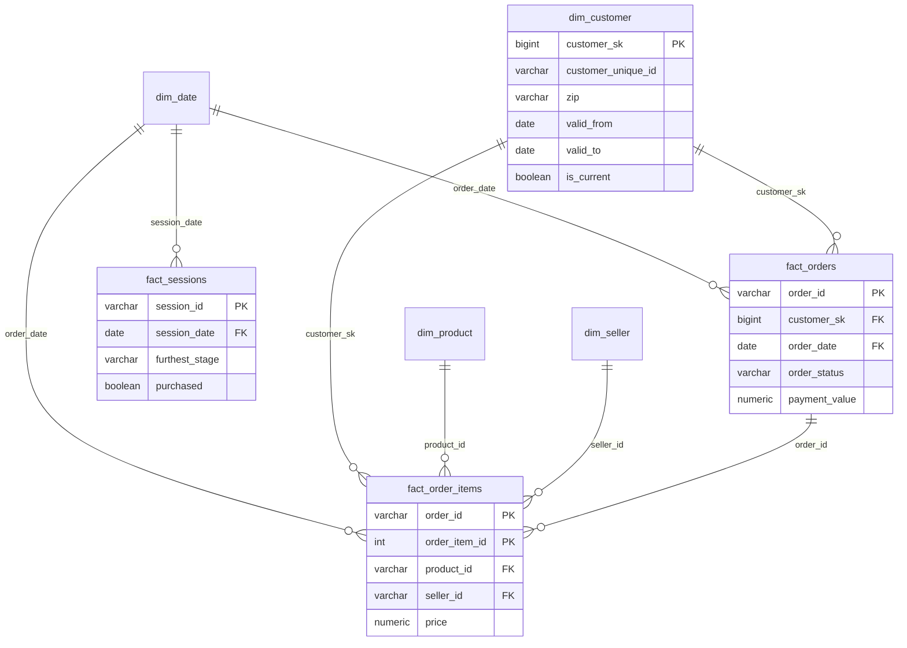

# Architecture (clean zone)

Flow: raw/dt=DAY -> clean_daily.py --dt DAY -> clean/<table>/ingest_dt=DAY
                                             -> quarantine/<table>/ingest_dt=DAY (with dq_reason)

Decisions
- One job processes all tables for one day.
- Pure functions in glue_jobs/common/ so logic is unit-testable without AWS.
- Clean zone is partitioned by ingest_dt (replay day), not event date. A late event
  must not overwrite an earlier day's partition (dynamic partition overwrite).
  Cross-day duplicates are resolved in the gold layer.
- Writes are idempotent: re-running a day replaces only that day's partition.
- The watermark advances only after a successful write.
- Timezones: Olist timestamps are Brazil local time (America/Sao_Paulo); generated events
  copy them, so they are also Brazil local. Everything is converted to UTC in clean.
  Spark session timezone is set to UTC.
- Quality rules are config (dq/rules.yaml). Severity: reject -> quarantine, warn -> keep and log.

## AWS deployment (event-driven ingestion)

### Flow

```
replay_s3.sh / replay.py --target s3
        |  uploads dt=YYYY-MM-DD/<table>/part-*, then _READY LAST
        v
 S3 raw bucket  --(ObjectCreated, suffix _READY)-->  Lambda cartflow-trigger
                                                         |  parse key, start run with --dt
                                                         v
                                              Glue job cartflow-clean-daily
                                    (Glue 5.0, G.1X x 2, 10 min timeout, 0 retries, 1 concurrent)
                          reads raw  -> schema + DQ rules -> UTC conversion
                          writes clean/ (Parquet, ingest_dt) and quarantine/ (with dq_reason)
                          advances watermark ONLY after both writes succeed
                                    |                                  |
                                    v                                  v
                         S3 clean + quarantine                 DynamoDB cartflow-watermarks
                                    |
                                    v
                    Athena (workgroup cartflow, database cartflow)
                    external tables, partition projection on ingest_dt
```

### Components

| Piece | Choice | Notes |
|---|---|---|
| Storage | 6 S3 buckets: raw, clean, gold, quarantine, scripts, athena-results | Created with `for_each` in Terraform |
| Trigger | S3 notification, `filter_suffix = _READY` | `aws_lambda_permission` created before the notification |
| Lambda | python3.12, `cartflow-trigger` | URL-decodes the key (`=` arrives as `%3D`), matches `^dt=YYYY-MM-DD/_READY$`, calls `start_job_run(--dt)` |
| Compute | Glue job `cartflow-clean-daily` | Code is `glue_jobs/`, helper modules shipped as a zip via `--extra-py-files` |
| State | DynamoDB `cartflow-watermarks` | One row per table, moves forward only |
| Query | Athena external tables | DDL generated from `schema.py` by `scripts/make_athena_ddl.py`; Parquet timestamps written as `TIMESTAMP_MILLIS` |
| Storage code | `glue_jobs/common/storage.py` | Same API for local paths and `s3://` URIs, so one job runs in both places |

### IAM (least privilege)

- **Glue role:** read raw and scripts; read, write and delete in clean and quarantine; read/write the one DynamoDB table; CloudWatch logs. Delete is needed for the empty-partition cleanup.
- **Lambda role:** `glue:StartJobRun` on this one job, plus logs.

### Key decisions

- **Marker-triggered, not file-triggered:** a day is many files, so one `_READY` written last means one run on a complete day.
- **One concurrent run, replay sequentially:** simpler watermark handling and a hard cost cap. `replay_day` waits for the run to finish.
- **Idempotent job:** retried or duplicate triggers are harmless. Dynamic partition overwrite replaces only that `ingest_dt`; the watermark moves last.
- **Partition projection instead of crawlers:** no crawler cost, new days are queryable immediately, and the schema has a single source of truth.
- **Local-first:** the same code was tested locally (19 tests) before any AWS spend.

### Results (verified)

| Check | Result |
|---|---|
| Local vs Athena, clean events | 197,639 = 197,639 |
| Local vs Athena, quarantined events | 2,979 = 2,979 |
| Re-run of 2017-11-20 on AWS | clean 10,155 and quarantine 157, unchanged |
| Watermarks | 9 rows in DynamoDB |
| Glue runs | 14 of 14 SUCCEEDED, 76 to 123 s each |
| Cost of the replay | 2,781 DPU-seconds, about 0.77 DPU-hours, about $0.34 at about $0.44 per DPU-hour |

Quarantine by reason: duplicate event_id 1,974; bad event_type 266; null/bad event_ts 259; null event_id 238; event_ts out of range 235; combined reasons 7.

### Known limits / next steps

- Local Terraform state and an IAM user key (single developer). Production: remote state with locking, role-based CI.
- No alarm or dead letter queue on failed runs.
- Foreign-key checks are deferred to gold, because the static dimension tables ship only on day 1.
- Gold layer (star schema, SCD2, MERGE) starts on Day 5.


## Gold star schema

Grain: `fact_orders` = one row per order. `fact_order_items` = one row per item in an order.
`fact_sessions` = one row per browsing session. `dim_customer` = one row per person per address period (SCD2).



Design notes: facts hold `customer_sk` so each order points at the customer's address *at order time*.
Validity is half-open (`valid_from <= d < valid_to`). The database enforces one current row per person.
Sessions have no FK to `dim_customer`, because most browsing people never ordered in the replay window.

## Day 5: gold layer and star schema

### Flow

```
clean Parquet (local lake)
        |  glue_jobs/build_gold.py  (Spark, session timezone UTC, Parquet TIMESTAMP_MILLIS)
        v
data/local_lake/gold/<table>/dt=YYYY-MM-DD/*.parquet
   fact_orders  fact_order_items  fact_sessions  customer_feed  dim_product  dim_seller
        |  warehouse/load_day.py  (DuckDB reads Parquet, TimeZone pinned to UTC)
        v
Postgres 16 (docker compose)  UNLOGGED stg_* tables with primary keys
        |  ONE transaction per day
        |  1. dimensions: dim_product, dim_seller (Type 1 MERGE), dim_customer (Type 2)
        |  2. facts: MERGE with point-in-time customer_sk lookup
        |  3. 8 invariant checks; any violation rolls the whole day back
        v
star schema: dim_date, dim_customer, dim_product, dim_seller, fact_orders, fact_order_items, fact_sessions
```

### Model

| Table | Grain | Notes |
|---|---|---|
| `fact_orders` | one row per order | statuses, timestamps (UTC), `delivered_late` (NULL until delivered), item, freight and payment totals |
| `fact_order_items` | one row per order item | price and freight; carries the customer version valid on the order date |
| `fact_sessions` | one row per browsing session | reached flags: viewed, carted, checkout_started, purchased |
| `dim_customer` | one row per person per address period (Type 2) | `valid_from <= d < valid_to`, `valid_to` NULL while current |
| `dim_product`, `dim_seller` | one row per entity (Type 1) | overwritten in place, no history |
| `dim_date` | one row per calendar day, 852 rows | 2016-09-01 to 2018-12-31, `is_black_friday` flag |

### Key decisions

- **Constraints live in the database.** `dim_customer` has half-open validity, a partial unique index (one current row per person), CHECKs (`valid_to > valid_from`, `is_current = (valid_to IS NULL)`) and `UNIQUE (customer_unique_id, valid_from)`. A buggy loader fails loudly instead of corrupting history.
- **Idempotent `MERGE`.** Matched rows are rewritten only when something changed (`IS DISTINCT FROM`), so re-running a day changes nothing. A reload test proves it.
- **Point-in-time lookup.** Facts take the customer version valid on the order date, so a later address change never rewrites history.
- **Business day is the Brazil date.** Storage is UTC; day logic converts. A check confirms zero orders fall outside their Brazil-day window.
- **Sessions are recomputed, not appended.** For every session touched on day D, the gold job recomputes it from all events up to D, so a late event that completes yesterday's session yields a complete row that the warehouse replaces wholesale.
- **Reached semantics** keep the funnel monotone even if an intermediate event was quarantined.
- **Customer feed carries `customer_id`.** The snapshot feed is one row per order, so every order links to a person. Found when orders failed to link; fixed in the slicer and schema (CSV columns are read by position).

### Results (verified)

| Check | Result |
|---|---|
| Rows | 4,380 orders, 5,062 items, 135,349 sessions, 32,951 products, 3,095 sellers |
| Customers | 4,322 dimension rows for 4,321 people: one real address change tracked as Type 2 |
| Tests | 47 passing in total, including 11 warehouse tests (throw-away schema) and 8 gold-builder tests |
| Reconciliation | Three-way (raw, clean, warehouse). One delivered order has no delivery date, so the quality rule quarantined it; the check lists it and quantifies the difference (items 574,136.76 vs 574,019.46) |
| Idempotency | Reloading a day leaves every count unchanged |

### Known limits

- Sessions are replaced wholesale, so the load is **order-dependent**: replaying an older day after newer ones can regress a session. See Day 6.
- The warehouse is local Postgres in Docker, not a managed service. Redshift was a one-off (Day 6).

---

## Day 6: AWS analytics, Redshift Serverless and dashboards

### Flow

```
S3 clean (Parquet) --> Athena raw-vs-clean benchmark --> docs/benchmark.md
gold Parquet --aws s3 sync (parquet only)--> S3 gold
        |  warehouse/load_day_redshift.py  (Redshift Data API, no VPC access needed)
        |  per day, ONE transaction: DELETE staging, COPY ... FORMAT AS PARQUET, dims, facts
        |  then a separate invariant-check statement
        v
Redshift Serverless (4 RPU base)  --reconcile_redshift.py-->  Postgres (14 checks)
        |
        v  terraform apply  (enable_redshift defaults to false)  =  teardown

Postgres star schema --> Metabase dashboards (docs/img/dashboard.png)
```

### Components

| Piece | Choice | Notes |
|---|---|---|
| Athena benchmark | raw JSON/CSV tables vs clean Parquet | Same four queries, median of 3 runs, bytes scanned from `get-query-execution` |
| Redshift | Serverless namespace and workgroup, 4 RPU base | Created by Terraform behind `enable_redshift`; a monthly usage limit of 40 RPU-hours deactivates compute |
| Loader | boto3 `redshift-data` | Batch of 1 to 40 statements runs as one transaction |
| Dashboards | Metabase in Docker on the local Postgres warehouse | QuickSight is denied by the sandbox account's service control policy |

### What changes from Postgres to Redshift

| Postgres | Redshift | Why |
|---|---|---|
| `GENERATED ALWAYS AS IDENTITY` | `IDENTITY(1,1)` | syntax |
| PK, UNIQUE, CHECK, partial unique index | PK/UNIQUE informational only; no CHECK, no partial index | not enforced, so the invariant checks are the only guard |
| UNLOGGED staging, `TRUNCATE` | plain tables emptied with `DELETE` | `TRUNCATE` commits implicitly and would break the transaction |
| `MERGE ... WHEN MATCHED AND (...) IS DISTINCT FROM (...)` | `MERGE ... WHEN MATCHED THEN UPDATE` | no `AND` condition on `WHEN`; matched rows are always rewritten, still idempotent |
| `IS DISTINCT FROM` in SCD2 | `COALESCE(a,'~') <> COALESCE(b,'~')` | not documented for Redshift |
| `FILTER (WHERE ...)` | `SUM(CASE WHEN ...)` | not available |
| COPY by column name via DuckDB | COPY Parquet **by position** | staging column order must equal the Parquet order |
| indexes | `DISTKEY` / `SORTKEY` / `DISTSTYLE ALL` | the two order facts share `DISTKEY(order_id)` so their join is co-located; dimensions are copied to every node; fact tables sorted by date |

### Key decisions

- **One switch for cost.** Every Redshift resource has `count = var.enable_redshift ? 1 : 0`. `terraform apply -var enable_redshift=true` builds it; a plain `terraform apply` destroys it, which is hard to get wrong.
- **Hard spending guard.** A usage limit stops compute after 40 RPU-hours in a month. A budget alert covers everything else.
- **Upload only Parquet to S3.** Spark also writes `_SUCCESS` and `.crc` files, and COPY reads every object under a prefix.
- **Independent verification.** A reconciliation script compares counts and money totals between Postgres and Redshift, because Redshift does not enforce constraints.

### Results (verified)

| Check | Result |
|---|---|
| Athena, one day, events by type | 5.07 MB raw, 0.01 MB clean (over 99% less) |
| Athena, whole-window funnel | 19.22 MB raw, 6.84 MB clean (64% less) |
| Athena, mobile events per day | 19.22 MB raw, 0.06 MB clean (over 99% less) |
| Athena, revenue by status (join) | 0.55 MB raw, 0.32 MB clean (42% less) |
| Postgres vs Redshift | 14 checks, ALL MATCH (counts and money totals to the cent) |
| Teardown | `list-workgroups` and `list-namespaces` both empty in us-east-2 |
| Glue | 26 runs of `cartflow-clean-daily` recorded in total; every run visible in the run-history screenshot succeeded |
| Total AWS cost | $0.68 |

The benchmark mixes compression, columnar and typing effects on tiny data, and Athena bills 10 MB minimum per query, so the ratio is the claim, not a dollar saving.

### What the reconciliation caught

1. **A skipped day.** The loader found its list of days from `fact_orders` only. 2017-12-01 has late-arriving sessions but no orders, so it was skipped and sessions were 129 short (purchased sessions 42 short).
2. **Order dependence.** After fixing it, 35 purchased sessions were still stale: re-loading 2017-11-24 after later days had overwritten newer session versions. All 35 were from that day, and the Redshift copies had fewer events and an earlier `session_end`. Replaying all days in date order produced ALL MATCH.

### Known limits

- **Order-dependent session loads.** Safe in date order. A version guard (drop staged sessions with fewer events than the stored row) would make any order safe; not implemented.
- **Redshift was a one-off** and cannot run in CI. The Redshift SQL and loader are verified by the reconciliation, not by automated tests.
- **Dashboards use local Postgres**, not QuickSight, because the account's service control policy denies it.
- Category names include upstream Olist typos and an `unknown` bucket.